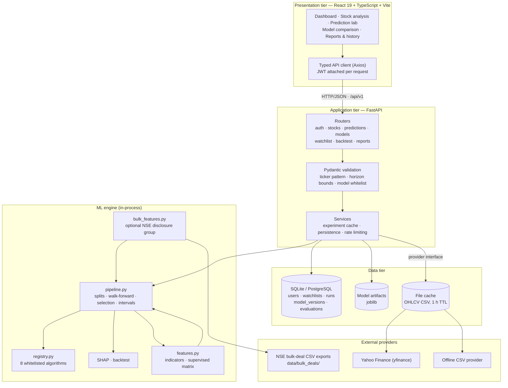
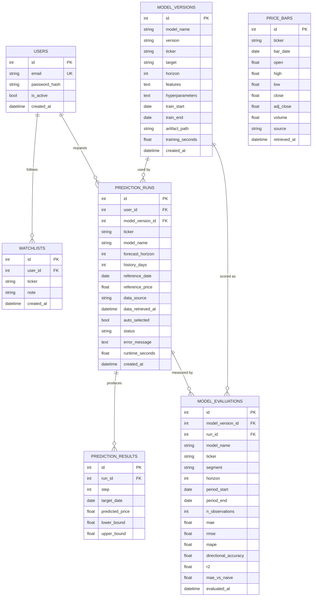
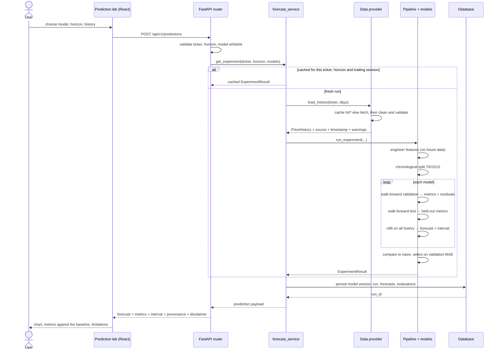
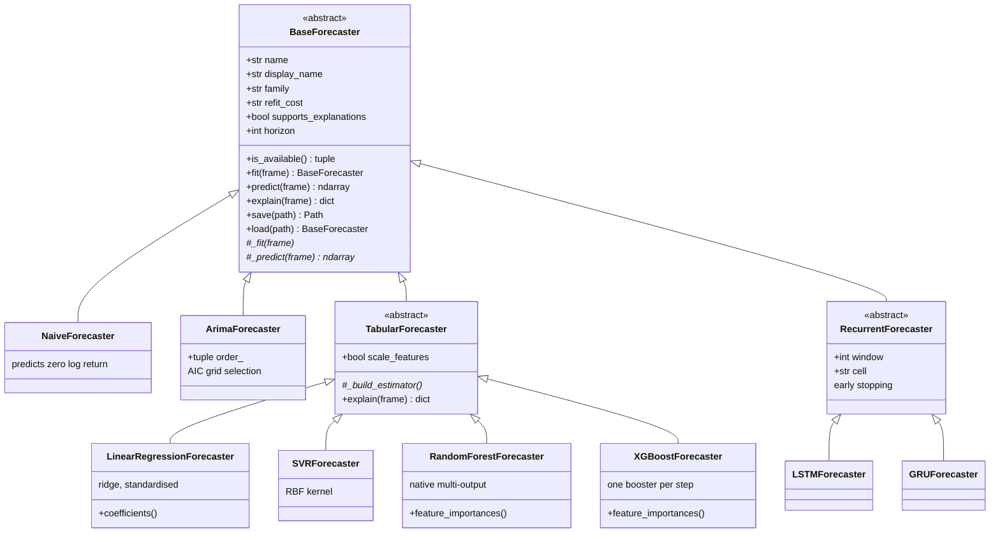
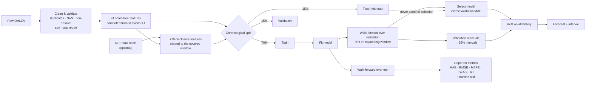
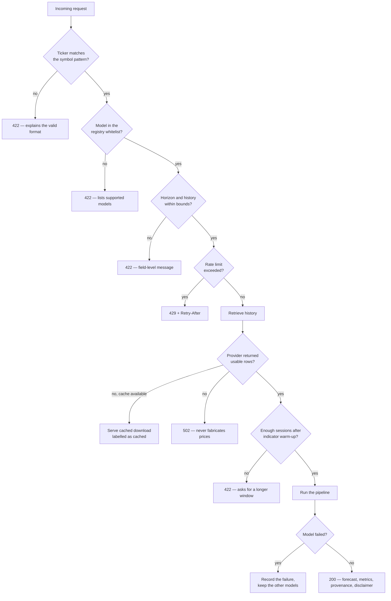
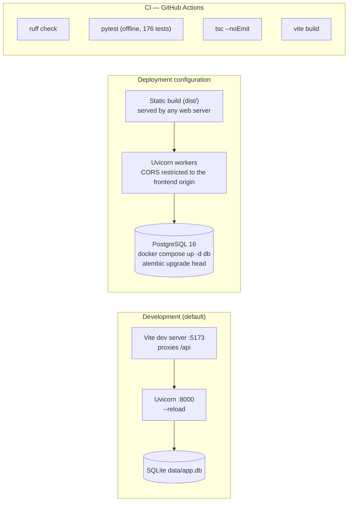

# Architecture and design documents

Diagrams are written in Mermaid, which GitHub and most Markdown viewers render directly.
Companion documents: [SRS.md](SRS.md) · [results/RESULTS.md](results/RESULTS.md)

---

## 1. System architecture

The ML engine runs inside the backend process. Because it is reached only through
`services/forecast_service.py`, moving it behind a task queue later would not change the API
contract or the frontend.

---

## 2. Entity-relationship diagram

`PRICE_BARS` is a standalone optional cache table; the running system caches OHLCV as CSV
files instead, so it has no foreign keys.

---

## 3. Sequence: generating a forecast

---

## 4. Class diagram: the model layer

Every model receives the feature frame up to the forecast origin and returns cumulative log
returns for `h = 1..horizon`. Because the interface is identical, the evaluation harness can
score a naive rule, a statistical model and a neural network on exactly the same quantities.

---

## 5. Data and evaluation flow

The dotted edge is the discipline the whole project rests on: the test window supplies the
numbers that are *reported*, never the numbers that *choose* a model.

---

## 6. Request validation and error paths

---

## 7. Deployment view

Secrets (`JWT_SECRET`, `DATABASE_URL`, any provider key) come from the environment in both
configurations and are never baked into the frontend bundle.
