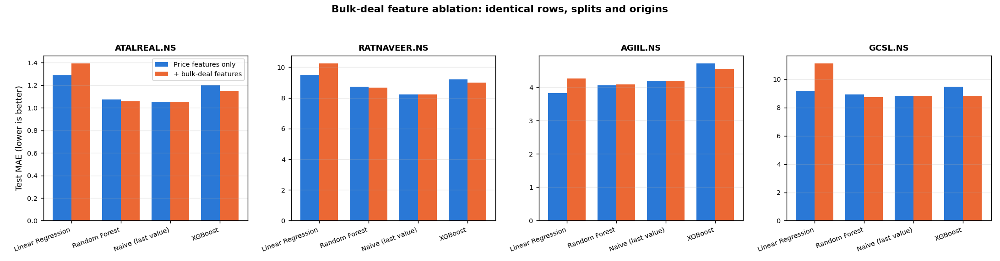

# Do NSE bulk-deal disclosures improve the forecasts?

Generated by `scripts/bulk_deals_ablation.py` on 2026-10-22 16:15 UTC.

## What was tested

A bulk deal is a single client trading more than 0.5% of a company's listed equity in one
session; NSE discloses the list after the close. Ten features are derived from it: whether a
deal occurred, how many, net and gross quantity relative to the session's volume, the deal
turnover relative to the session's turnover, the buy/sell imbalance, the premium of the deal
price to the close, 5- and 20-session rolling net pressure, and the number of sessions since
the last disclosure.

**This is a controlled ablation.** Both arms use the same rows, the same chronological
70/15/15 split and the same walk-forward origins, evaluated at every origin. The only
difference is whether those ten columns are present, so any change in error is attributable
to the feature group and not to a different window. The naive baseline is kept in the table
as a check: having no features, its two columns must be identical, and they are.

Two constraints matter before reading the numbers:

* The export covers 2025-10-23 to 2026-10-21, so the evaluation window is
  about 245 sessions instead of the ~700 used elsewhere in this
  project, leaving roughly 36 test origins. Differences of a few percent sit inside the noise
  of a window that size.
* Large-capitalisation stocks essentially never appear in this report, so these are small and
  mid caps, which are more volatile and harder to forecast than the large caps used in the
  main experiment.

## Results

| Ticker | Model | Sessions | With deals | Test MAE (price only) | Test MAE (+ bulk deals) | Change | Helped |
| --- | --- | --- | --- | --- | --- | --- | --- |
| ATALREAL.NS | Linear Regression | 245 | 131 | 1.2881 | 1.3935 | 8.18% | no |
| ATALREAL.NS | Random Forest | 245 | 131 | 1.0745 | 1.0570 | -1.63% | yes |
| ATALREAL.NS | Naive (last value) | 245 | 131 | 1.0522 | 1.0522 | 0.00% | no |
| ATALREAL.NS | XGBoost | 245 | 131 | 1.2027 | 1.1452 | -4.78% | yes |
| RATNAVEER.NS | Linear Regression | 245 | 107 | 9.5023 | 10.2465 | 7.83% | no |
| RATNAVEER.NS | Random Forest | 245 | 107 | 8.7248 | 8.6642 | -0.69% | yes |
| RATNAVEER.NS | Naive (last value) | 245 | 107 | 8.2125 | 8.2125 | 0.00% | no |
| RATNAVEER.NS | XGBoost | 245 | 107 | 9.2030 | 8.9986 | -2.22% | yes |
| AGIIL.NS | Linear Regression | 245 | 80 | 3.8277 | 4.2641 | 11.40% | no |
| AGIIL.NS | Random Forest | 245 | 80 | 4.0518 | 4.0820 | 0.75% | no |
| AGIIL.NS | Naive (last value) | 245 | 80 | 4.1985 | 4.1985 | 0.00% | no |
| AGIIL.NS | XGBoost | 245 | 80 | 4.7110 | 4.5533 | -3.35% | yes |
| GCSL.NS | Linear Regression | 227 | 65 | 9.1972 | 11.1265 | 20.98% | no |
| GCSL.NS | Random Forest | 227 | 65 | 8.9406 | 8.7238 | -2.42% | yes |
| GCSL.NS | Naive (last value) | 227 | 65 | 8.8318 | 8.8318 | 0.00% | no |
| GCSL.NS | XGBoost | 227 | 65 | 9.4790 | 8.8495 | -6.64% | yes |

### By model

| Model | Tickers improved | Mean change in test MAE |
| --- | --- | --- |
| XGBoost | 4 of 4 | -4.25% |
| Random Forest | 3 of 4 | -1.00% |
| Linear Regression | 0 of 4 | +12.10% |

## Did the models even use the features?

| Ticker | Model | Share of feature importance on bulk-deal columns |
| --- | --- | --- |
| ATALREAL.NS | Random Forest | 22.1% |
| ATALREAL.NS | XGBoost | 33.2% |
| RATNAVEER.NS | Random Forest | 13.9% |
| RATNAVEER.NS | XGBoost | 24.8% |
| AGIIL.NS | Random Forest | 16.7% |
| AGIIL.NS | XGBoost | 27.7% |
| GCSL.NS | Random Forest | 15.5% |
| GCSL.NS | XGBoost | 28.2% |

Ten of the thirty-four columns are bulk-deal features, so a model that ignored them
entirely would show roughly 0%, and one that weighted them like any other feature would
show roughly 29%.

## Conclusion

The feature group reduced test MAE in **7 of 12** model/ticker
combinations, and the effect splits by model family:

* **XGBoost** - helped on average (-4.25%), improving on 4 of 4 tickers.
* **Random Forest** - helped on average (-1.00%), improving on 3 of 4 tickers.
* **Linear Regression** - hurt on average (+12.10%), improving on 0 of 4 tickers.

That split is the interesting part, and the feature-importance table explains it. A tree model
can use a sparse, mostly-zero column when it carries information and ignore it otherwise, so
ten extra columns cost it little and sometimes help. The linear model has no such defence: ten
more coefficients estimated from roughly 170 training rows add variance, and it is worse on
every ticker tested.

**The gains are small and the window is short.** A few percent of MAE over ~36 test origins is
not a result to lean on, and the decisive comparison is still against the naive baseline:

only **3 of 12** combinations beat the naive last-value
forecast at all (Linear Regression on AGIIL.NS, Random Forest on AGIIL.NS, Random Forest on GCSL.NS), and the disclosures do not change that picture.

The honest reading: bulk-deal disclosures are **sparse, lagging and public**. They record that
a large trade already happened, in a report published after the session closed, by which time
the price has already moved. A consistent next-session edge was never likely, and this
experiment does not find one. What it does show is that the feature group is wired in
correctly, that the tree models use it, and that its contribution is measured rather than
assumed.

A more defensible use of the same data is descriptive rather than predictive: the dashboard
shows who traded, on which side, in what size and at what premium to the close, which is
information an analyst can act on directly without a model in the middle.
