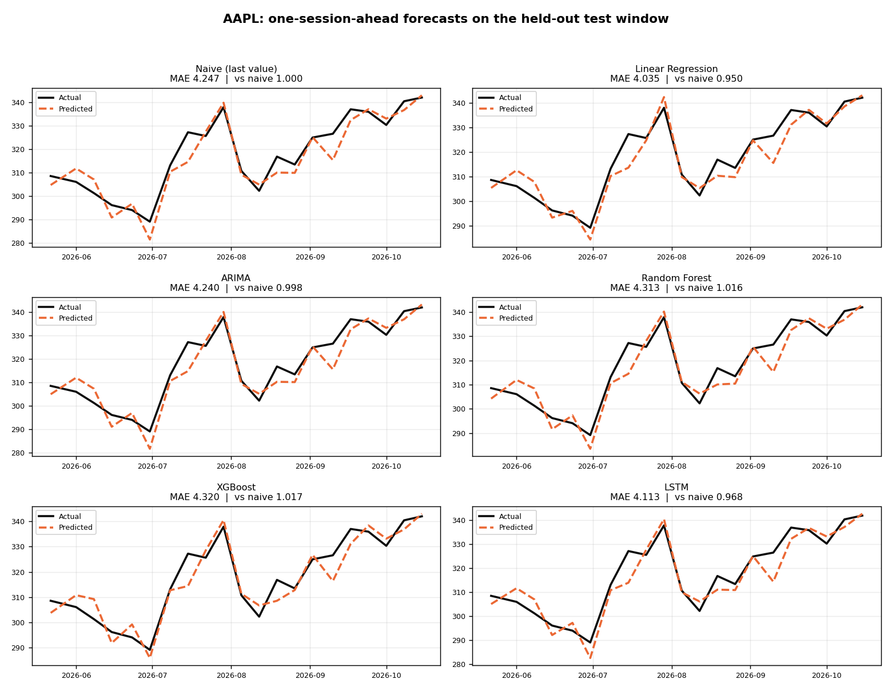
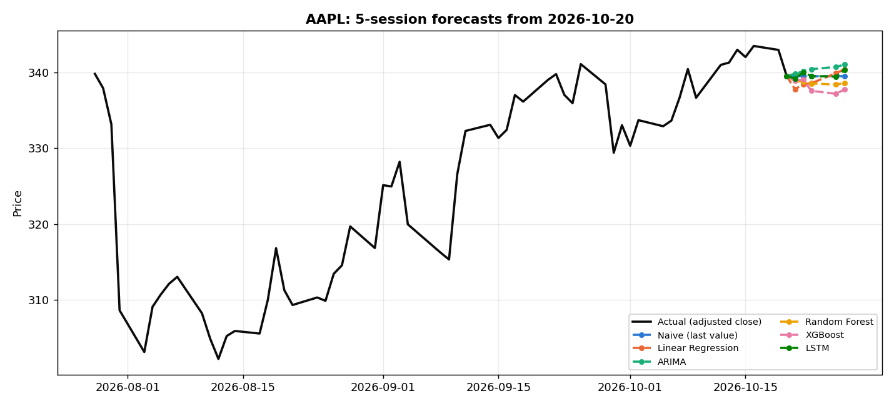
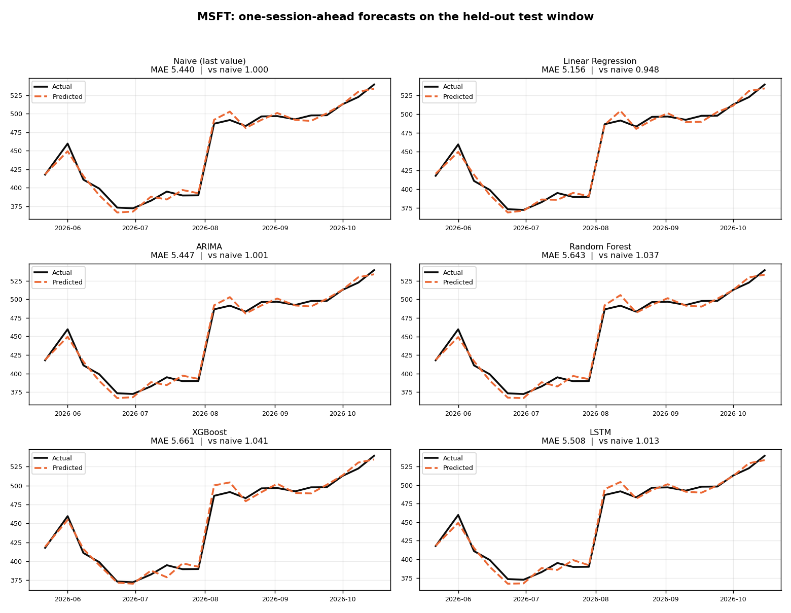
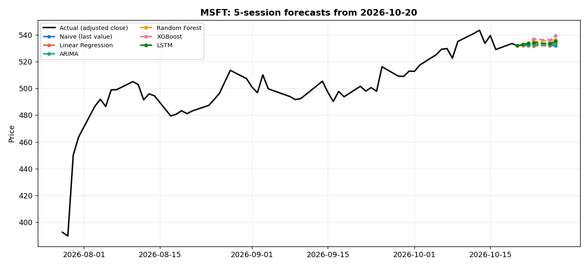
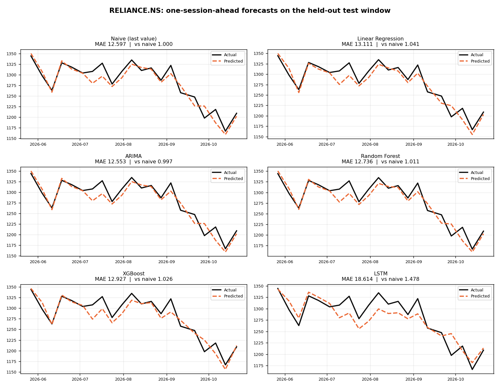
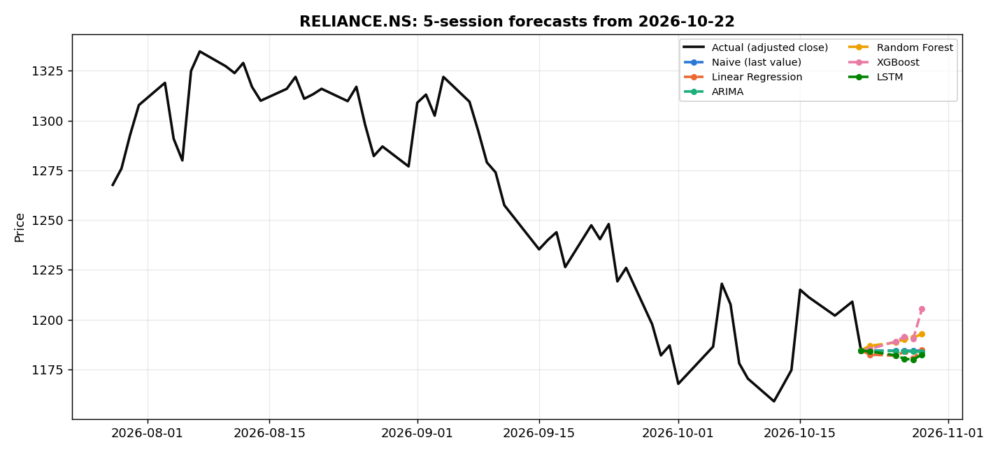

# Experimental results

Generated by `scripts/run_experiments.py` on 2026-10-22 13:00 UTC.

Every number below was measured by the project's own pipeline. Reproduce with:

```bash
python scripts/run_experiments.py --tickers AAPL MSFT RELIANCE.NS --horizon 5 --models naive linear_regression arima random_forest xgboost lstm
```

## Method

* Prediction target: cumulative log return over the next *h* trading sessions, converted back to a price.
* Features: lagged returns, moving-average ratios, RSI, MACD, realised volatility and volume features, each computed only from sessions up to the forecast origin.
* Split: 70% train, 15% validation, 15% test, in chronological order with no shuffling.
* Evaluation: walk-forward origins through each segment; cheap models refit on the expanding window, ARIMA and the recurrent models are fitted once per segment and rolled forward.
* Selection: lowest one-session-ahead validation MAE. The test window is never used to choose a model.
* `MAE / naive` below 1.0 means the model beat the naive last-value forecast on unseen data.

## AAPL

* Data source: yfinance, retrieved 2026-10-22 12:43 UTC
* Sessions: 751 downloaded, 702 usable after indicator warm-up
* Train 491 (2024-01-03 to 2025-12-16), validation 106 (2025-12-17 to 2026-05-20), test 105 (2026-05-21 to 2026-10-20)
* Forecast origin: 2026-10-20 at 339.50
* Horizon: 5 trading session(s); total runtime 130.6s

| Model | Family | Val MAE | Test MAE | Test RMSE | Test MAPE % | Dir. acc. | R² | MAE / naive | Beats naive | Fit (s) |
| --- | --- | --- | --- | --- | --- | --- | --- | --- | --- | --- |
| Random Forest **(selected)** | machine_learning | 1.518 | 4.313 | 5.307 | 1.37 | 0.381 | 0.889 | 1.016 | no | 0.51 |
| Linear Regression | statistical | 1.669 | 4.035 | 5.250 | 1.27 | 0.524 | 0.891 | 0.950 | yes | 0.00 |
| Naive (last value) | baseline | 1.769 | 4.247 | 5.290 | 1.35 | n/a | 0.889 | 1.000 | n/a | 0.00 |
| LSTM | deep_learning | 1.801 | 4.113 | 5.253 | 1.30 | 0.571 | 0.891 | 0.968 | yes | 1.95 |
| XGBoost | machine_learning | 1.820 | 4.320 | 5.360 | 1.36 | 0.381 | 0.887 | 1.017 | no | 1.88 |
| ARIMA | statistical | 1.895 | 4.240 | 5.206 | 1.34 | 0.524 | 0.893 | 0.998 | yes | 1.17 |


Models that beat the naive baseline on the test window: Linear Regression, LSTM, ARIMA.





## MSFT

* Data source: yfinance, retrieved 2026-10-22 12:47 UTC
* Sessions: 751 downloaded, 702 usable after indicator warm-up
* Train 491 (2024-01-03 to 2025-12-16), validation 106 (2025-12-17 to 2026-05-20), test 105 (2026-05-21 to 2026-10-20)
* Forecast origin: 2026-10-20 at 531.87
* Horizon: 5 trading session(s); total runtime 206.6s

| Model | Family | Val MAE | Test MAE | Test RMSE | Test MAPE % | Dir. acc. | R² | MAE / naive | Beats naive | Fit (s) |
| --- | --- | --- | --- | --- | --- | --- | --- | --- | --- | --- |
| Naive (last value) **(selected)** | baseline | 5.489 | 5.440 | 6.295 | 1.23 | n/a | 0.987 | 1.000 | n/a | 0.00 |
| ARIMA | statistical | 5.551 | 5.447 | 6.291 | 1.24 | 0.476 | 0.987 | 1.001 | no | 1.77 |
| Linear Regression | statistical | 6.050 | 5.156 | 6.065 | 1.14 | 0.571 | 0.988 | 0.948 | yes | 0.00 |
| Random Forest | machine_learning | 6.251 | 5.643 | 6.708 | 1.28 | 0.381 | 0.985 | 1.037 | no | 0.83 |
| LSTM | deep_learning | 6.817 | 5.508 | 6.498 | 1.25 | 0.524 | 0.986 | 1.013 | no | 3.12 |
| XGBoost | machine_learning | 7.066 | 5.661 | 6.958 | 1.26 | 0.286 | 0.984 | 1.041 | no | 2.16 |


Models that beat the naive baseline on the test window: Linear Regression.





## RELIANCE.NS

* Data source: yfinance, retrieved 2026-10-22 12:49 UTC
* Sessions: 740 downloaded, 689 usable after indicator warm-up
* Train 482 (2024-01-04 to 2025-12-17), validation 104 (2025-12-18 to 2026-05-25), test 103 (2026-05-26 to 2026-10-22)
* Forecast origin: 2026-10-22 at 1184.50
* Horizon: 5 trading session(s); total runtime 180.0s

| Model | Family | Val MAE | Test MAE | Test RMSE | Test MAPE % | Dir. acc. | R² | MAE / naive | Beats naive | Fit (s) |
| --- | --- | --- | --- | --- | --- | --- | --- | --- | --- | --- |
| Linear Regression **(selected)** | statistical | 17.644 | 13.111 | 16.045 | 1.03 | 0.429 | 0.891 | 1.041 | no | 0.01 |
| XGBoost | machine_learning | 17.830 | 12.927 | 16.759 | 1.01 | 0.619 | 0.881 | 1.026 | no | 2.60 |
| Random Forest | machine_learning | 18.116 | 12.736 | 16.137 | 1.00 | 0.476 | 0.890 | 1.011 | no | 0.76 |
| ARIMA | statistical | 18.635 | 12.553 | 15.913 | 0.99 | 0.714 | 0.893 | 0.997 | yes | 1.85 |
| Naive (last value) | baseline | 18.704 | 12.597 | 15.950 | 0.99 | n/a | 0.893 | 1.000 | n/a | 0.00 |
| LSTM | deep_learning | 19.287 | 18.614 | 22.685 | 1.45 | 0.524 | 0.783 | 1.478 | no | 4.46 |


Models that beat the naive baseline on the test window: ARIMA.





## Reading these results

A low MAE on a daily closing price is easy to achieve by predicting almost no change, which is exactly
what the naive baseline does. The columns that matter are `MAE / naive` and directional accuracy: a model
only demonstrates predictive skill when it beats the baseline on the test window, and directional accuracy
near 0.5 is what an uninformative forecast produces on daily equity data.

These results describe the tickers and periods listed above. They are not a general claim about the
algorithms, and they are not investment advice.
